<!-- Every card is an animated SVG drawn by scripts/render_readme_cards.py and refreshed daily
     by .github/workflows/update-profile-art.yml. Design: "Three Worlds", built around Vruxak's work.
     Spacing is baked into the SVGs, so keep this block free of blank lines and keep the cards in
     a row on one line with no spaces between them. -->

 
 
 
 
<picture><source media="(prefers-color-scheme: dark)" srcset="./cards/title-coding-dark.svg" /></picture> 

<a href="https://github.com/Vruxak21">github</a> &nbsp;/&nbsp; <a href="https://linkedin.com/in/vruxak-patel">linkedin</a> &nbsp;/&nbsp; <a href="https://leetcode.com/u/Vruxak21/">leetcode</a> &nbsp;/&nbsp; <a href="https://codeforces.com/profile/Vruxak21">codeforces</a>
 Design inspired by <a href="https://github.com/AVIVASHISHTA29/AVIVASHISHTA29">Avi Vashishta's original profile README</a>.

